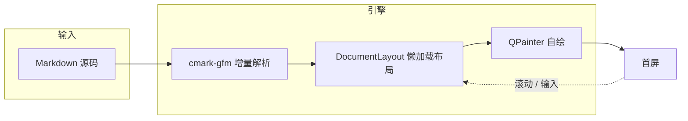
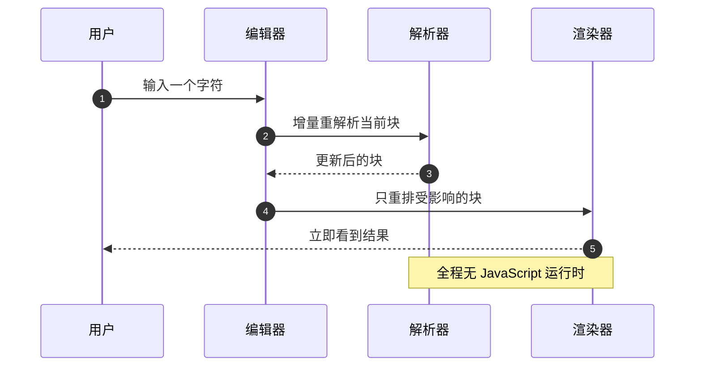
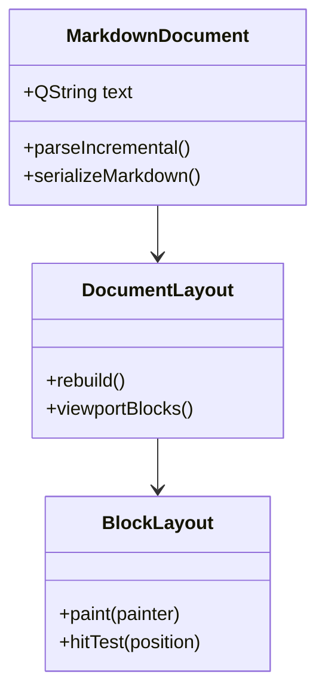
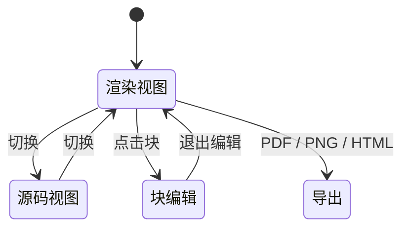
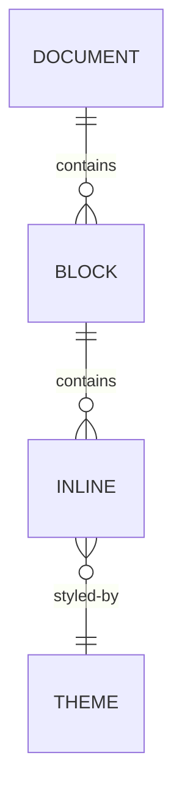
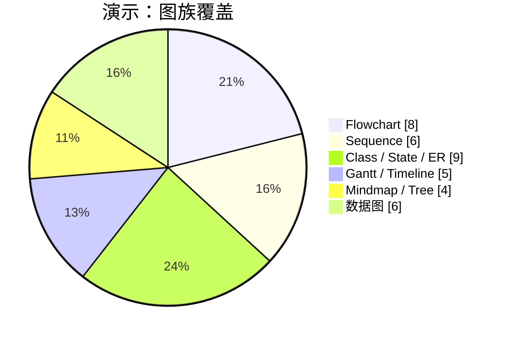
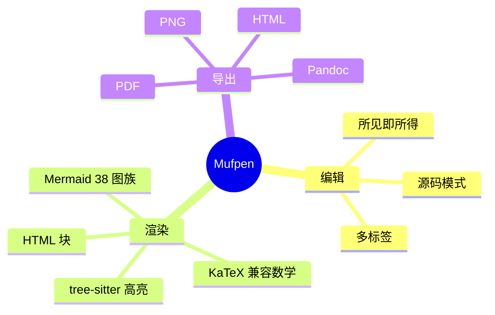
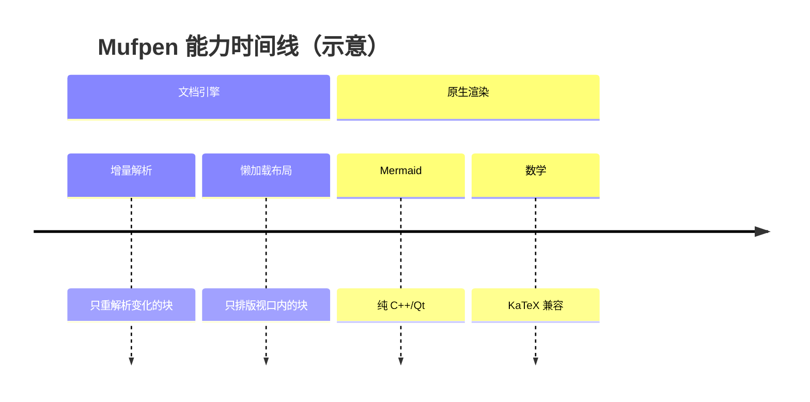
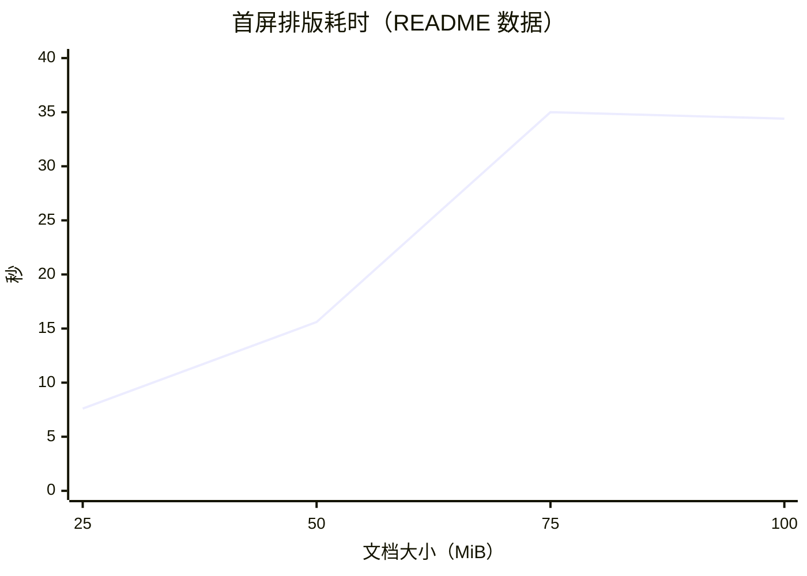
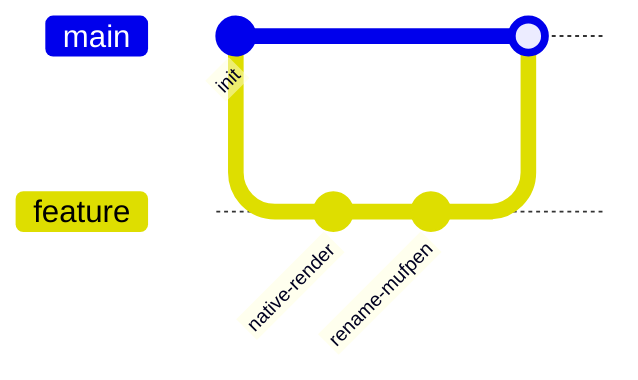

# Mufpen 功能展示

> 这是一份“可交互的说明书”。所有内容都在渲染视图里直接编辑：
> 点击段落写作，点击表格改单元格，点击代码块改代码，点击图表改 Mermaid 源码。
>
> 试试 `F8` 专注模式、`F9` 打字机模式，以及 `Ctrl+P` 快速打开。

[TOC]

---

## 1. 行内格式

**粗体**、*斜体*、***粗斜体***、~~删除线~~、`行内代码`、==高亮==、H~2~O 下标、x^2^ 上标。

GitHub 风格的 emoji 短代码会直接渲染成字形：:smile: :rocket: :heart: :sparkles:。

段落里也可以直接写 <span style="color:#e11d48;font-weight:700;">行内 HTML</span>、<mark>mark</mark>、<kbd>Ctrl</kbd>+<kbd>P</kbd>、H<sub>2</sub>O 和 x<sup>2</sup>。

> 智能标点在输入时生效：直引号会变成弯引号，`--` 变成短破折号，`---` 变成破折号，`...` 变成省略号。也可以在偏好设置里改成“仅渲染、不改源码”。

## 2. 图片

Markdown 图片按文档所在目录解析相对路径：


HTML `` 支持 `width`、`height`、`alt` 和 `style`：


图片还可以来自 `https://` 远程地址、`data:` URI、WebP 和 AVIF。拖动图片边缘或通过右键菜单可以调整显示尺寸，插入策略（复制到 `./assets`、上传到自定义目录等）在偏好设置里统一配置。

## 3. 数学公式

行内公式用 `$...$`：质能方程 $E = mc^2$，欧拉恒等式 $e^{i\pi} + 1 = 0$，量子态 $\braket{\psi|\hat{H}|\psi}$。

块级公式用 `$$...$$`：

$$
\int_{-\infty}^{\infty} e^{-x^2}\,\mathrm{d}x = \sqrt{\pi}
$$

`aligned`、`pmatrix`、`cases` 等环境都可以用：

$$
\begin{aligned}
\nabla \cdot \mathbf{E} &= \frac{\rho}{\varepsilon_0} \\
\nabla \cdot \mathbf{B} &= 0 \\
\nabla \times \mathbf{E} &= -\frac{\partial \mathbf{B}}{\partial t}
\end{aligned}
$$

$$
A = \begin{pmatrix} a & b \\ c & d \end{pmatrix},
\qquad \det(A) = ad - bc,
\qquad
f(x) = \begin{cases}
x^2, & x \ge 0 \\
-x,  & x < 0
\end{cases}
$$

Braket 记号和交换图也是内置的：

$$
\braket{\phi|\hat{H}|\psi} = \sum_n E_n \braket{\phi|n}\braket{n|\psi}
$$

$$
\begin{CD}
A @>a>> B \\
@VbVV @AAcA \\
C @>>d> D
\end{CD}
$$

也可以用 LaTeX 风格的 `\[ ... \]`：

\[
\lim_{n\to\infty}\left(1+\frac{1}{n}\right)^n = e
\]

> 数学引擎是原生 C++ 实现、兼容 KaTeX 语法，不加载 MathJax/KaTeX 的 JavaScript。公式块支持编辑/预览双面板和自定义宏。

## 4. Mermaid 图表

Mermaid 使用纯 C++/Qt 引擎渲染，支持 Mermaid 11.16 的全部 **38 个图族 ID**，不依赖 JavaScript 或浏览器。点击任意图表可以修改源码，右键可以保存 SVG/PNG。

### 4.1 Flowchart



### 4.2 Sequence



### 4.3 Class



### 4.4 State



### 4.5 ER



### 4.6 Gantt


### 4.7 Pie



### 4.8 Mindmap



### 4.9 Timeline



### 4.10 XY Chart



### 4.11 GitGraph



还有流程图泳道、需求图、象限图、旅程图、雷达图、报文图、看板、Block、C4、TreeView、事件建模、石川图、维恩图、桑基图、树图、Cynefin、Wardley、架构图、Info、Railroad/EBNF/ABNF/PEG 语法图等图族。无效的 Mermaid 源码会保持可编辑，并显示精确的行列诊断和点击跳转。

无头批量渲染：

```bash
mufpen-mmdc -i diagram.mmd -o diagram.svg
mufpen-mmdc -i diagram.mmd -o diagram.png --scale 2 --background white
```

## 5. HTML 块

HTML 块就是直接写在 Markdown 里的标签，由 Lexbor 解析、Yoga 做 flexbox 布局、QPainter 绘制，并跟随当前文档主题。下面这个块是真实渲染的，不是代码示例——切到源码模式就能看到它的原始 HTML。

<details open>
  <summary>可折叠的 HTML 块：内部也支持布局</summary>
  <div style="display:flex; align-items:center; padding:16px; background-color:#eef6ff; border:1px solid #93c5fd; border-radius:12px;">
    
    <div style="margin-left:16px;">
      <div style="font-size:18px; font-weight:700;">原生 HTML 块</div>
      <div>Lexbor 解析 → Yoga 布局 → QPainter 绘制</div>
    </div>
  </div>
</details>

HTML 表格，含 `colspan` / `rowspan`：

<table>
  <thead>
    <tr><th>层</th><th>职责</th><th>来源</th></tr>
  </thead>
  <tbody>
    <tr><td>Lexbor</td><td>HTML 解析</td><td>third_party</td></tr>
    <tr><td>Yoga</td><td>flexbox 布局</td><td>third_party</td></tr>
    <tr><td>QPainter</td><td>直接绘制</td><td>Qt 6</td></tr>
  </tbody>
</table>

**边界说明**：HTML 块不是浏览器。`<script>` 不执行，`<style>`、`<head>`、`<template>` 会被跳过；样式来自主题 CSS、`class` 或内联 `style`，支持的是 CSS 子集加 Yoga flexbox，没有 iframe 或 Web 组件。

## 6. 代码块

代码块内联编辑，使用 tree-sitter 做原生语法高亮，支持 20+ 种语言。

```cpp
// C++
class BlockLayout {
public:
  void paint(QPainter& painter, const RenderTheme& theme) const;
  bool hitTest(QPointF position) const;
};
```

```python
# Python
def parse_incremental(text: str) -> list[Block]:
    return [block for block in split_blocks(text) if block.changed]
```

```rust
// Rust
fn main() {
    let document = MarkdownDocument::open("notes.md");
    println!("{} blocks", document.blocks().len());
}
```

```bash
# 构建与测试
cmake --build --preset conan-release
ctest --preset conan-release --output-on-failure
```

## 7. 表格、任务列表与引用

GFM 表格，支持左/中/右对齐、行内格式和代码：

| 能力 | 是否原生 | 说明 |
| :--- | :------: | ----: |
| Mermaid | ✅ | 38 个图族 ID，纯 C++/Qt |
| 数学公式 | ✅ | KaTeX 兼容，原生排版 |
| HTML 块 | ✅ | Lexbor + Yoga |
| PDF 导出 | ✅ | 原生导出，无浏览器 |

- [x] 原生渲染 Markdown
- [x] 超大文档懒加载布局
- [x] 原生 Mermaid 与数学公式
- [ ] 你的下一个需求

> 普通引用块也支持多级嵌套和主题样式。
>
> > 嵌套引用：
> > 引用的引用。

## 8. GitHub 风格提示框

> [!NOTE]
> 适合补充说明。

> [!TIP]
> 适合给出建议或快捷操作。

> [!IMPORTANT]
> 适合必须知道的信息。

> [!WARNING]
> 适合风险提示。

> [!CAUTION]
> 适合可能导致数据丢失的操作。

## 9. 脚注与链接引用

Mufpen 的文档模型是结构化的块树[^model]，渲染视图和源码视图共享同一份偏移映射[^projection]。

[^model]: 导入时 Markdown 被解析为可编辑块；保存时重新序列化为规范化 Markdown。

[^projection]: 双向行内投影让渲染视图中的光标、选区与原始源码位置保持一致。

链接引用定义：

[mufpen-repo]: https://github.com/asdacffgg/Mufpen
[mufpen-upstream]: https://github.com/jstzwj/Muffin

- [Mufpen 仓库][mufpen-repo]
- [上游 Muffin][mufpen-upstream]

## 10. 其他语法

Setext 二级标题（下一行是 `---`）：

Setext 标题示例
---

分隔线：

---

Front Matter 在文件顶部，用来保存文章元数据；它会被解析、编辑和原样写回。

## 11. 编辑能力速查

- **所见即所得**：渲染页面就是编辑器，没有并排预览。
- **源码模式**：随时切回原始 Markdown，两个视图的光标与选区互通。
- **专注模式 / 打字机模式**：`F8` / `F9`。
- **多标签页**：`Ctrl+N` 新建，`Ctrl+Tab` 切换，拖动排序。
- **快速打开**：`Ctrl+P`，支持文件名、相对路径、多关键词和字符模糊匹配。
- **目录搜索与替换**：`Ctrl+Shift+F` / `Ctrl+Shift+H`。
- **文档大纲**：侧边栏跳转任意标题，长文档可折叠。
- **会话与草稿恢复**：退出后恢复标签、光标和阅读位置；崩溃后恢复未保存内容。
- **自动保存**：可选定时保存与退出时保存。
- **拼写检查**：Nuspell，渲染模式和源码模式都支持，内置 11 种语言词典。
- **图片插入策略**：统一管控粘贴、拖放和对话框插入。
- **多格式导出**：原生 PDF / PNG / HTML；通过 Pandoc 导出 DOCX、ODT、RTF、ePub、LaTeX 等。
- **文档打印**：`Alt+Shift+P`。
- **15 种界面语言**，全部离线可用。

---

> 这份文件本身就是普通 Markdown：可以用任何编辑器打开，也可以在 Mufpen 里直接修改后保存。
